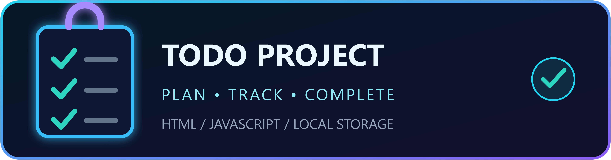
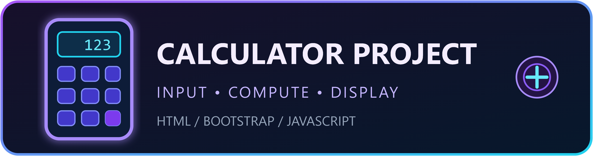

### Building thoughtful experiences for the web

 

---

## 👋 About me

I'm **Abhishek Sawant**, a Mechanical Engineering graduate transitioning into software development. I’m focused on frontend development and React.js, and I learn by building projects, strengthening fundamentals, and improving with each iteration.

- 🎯 Seeking an entry-level frontend developer role
- 🌱 Currently learning React.js, Firebase, and Python
- 💻 Practicing problem-solving and data structures with C
- 🤝 Open to junior opportunities, collaboration, and feedback

## 🧰 Tech stack

  

**Frontend:** HTML · CSS · JavaScript · React.js · Bootstrap  
**Backend and data:** Firebase · Python fundamentals  
**Programming:** C  
**Tools:** Git · GitHub · VS Code

## 🚀 Featured projects

### Todo Project

A lightweight task manager built with HTML and JavaScript. It uses browser Local Storage to retain tasks after a page refresh.

**Built with:** HTML · JavaScript · Local Storage

### Calculator Project

A browser-based calculator built with HTML, Bootstrap, and JavaScript, combining a styled interface with basic calculator interactions.

**Built with:** HTML · Bootstrap · JavaScript

## 📊 GitHub analytics

  

## 📚 What I'm learning

- Creating reusable React components and responsive interfaces
- Using Firebase services and working with application data
- Improving programming fundamentals and problem-solving

## 📫 Let's connect

[GitHub profile](https://github.com/abhisheksawant172002-glitch) · [All repositories](https://github.com/abhisheksawant172002-glitch?tab=repositories)

Thanks for stopping by — I’m excited to keep learning and contribute to a team.

