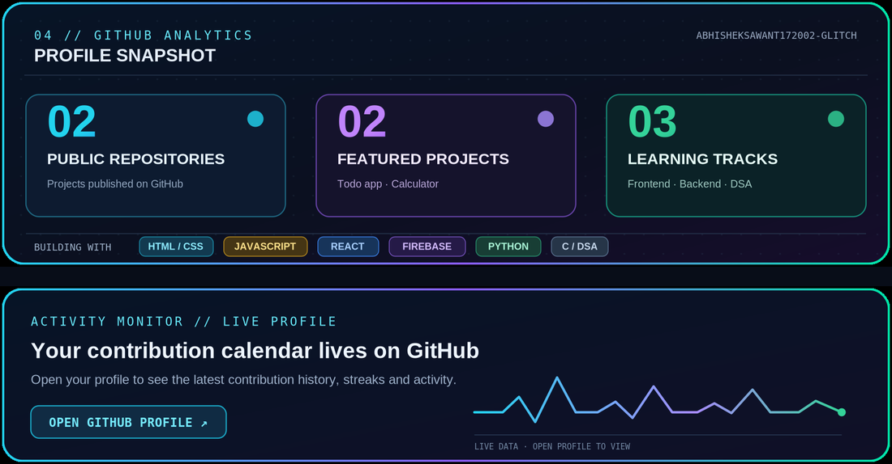

<!--
  PROFILE README
  Repository name: abhisheksawant172002-glitch
  Theme: dark / neon / developer-console
-->

  <!-- HERO / DIGITAL HEADER -->
  

  

   

  
  
  

---

<!-- PROFILE CONSOLE -->

<table width="100%">
  <tr>
    <td width="31%" align="center" valign="middle">
      
        
      <strong>abhisheksawant172002-glitch</strong>
       
      <code>DEVELOPER PROFILE // ONLINE</code>
        
      <a href="https://github.com/abhisheksawant172002-glitch?tab=repositories">[ REPOSITORIES ]</a>
    </td>
    <td valign="middle">
      <h2>▸ Developer Snapshot</h2>
      
Hey! I'm <strong>Abhishek Sawant</strong> — a Mechanical Engineering graduate moving into software development, with a current focus on <strong>frontend engineering and React.js</strong>.

      
I enjoy learning how things work, building practical projects, and improving them one iteration at a time. My approach is simple: understand the fundamentals, write the code, test it, and keep refining.

      

        <code>FOCUS :: Frontend Development</code> 
        <code>LEARNING :: React.js · Firebase · Python</code> 
        <code>PROBLEM SOLVING :: Data Structures & Algorithms in C</code>
      

    </td>
  </tr>
</table>

---

## `01 // TECH STACK`

  
TOOLS & TECHNOLOGIES I'M USING OR CURRENTLY LEARNING

  

<table width="100%">
  <tr>
    <td width="50%" valign="top">
      <strong>◈ FRONTEND</strong> 
      HTML · CSS · JavaScript · React.js · Bootstrap
    </td>
    <td width="50%" valign="top">
      <strong>◈ BACKEND & DATA</strong> 
      Python · Firebase
    </td>
  </tr>
  <tr>
    <td width="50%" valign="top">
      <strong>◈ PROGRAMMING</strong> 
      C · JavaScript · Python fundamentals
    </td>
    <td width="50%" valign="top">
      <strong>◈ DEVELOPER TOOLS</strong> 
      Git · GitHub · VS Code
    </td>
  </tr>
</table>

---

## `02 // FEATURED PROJECTS`

SELECTED BUILDS · CLICK A PROJECT TO INSPECT THE SOURCE

<table width="100%">
  <tr>
    <td width="50%" valign="top">
      <h3>▣ Todo Project</h3>
      
A simple task manager built with HTML and JavaScript. It uses browser Local Storage to keep tasks available after a page refresh.

      

        
        
        
      

      <a href="https://github.com/abhisheksawant172002-glitch/Todo-project"><strong>OPEN REPOSITORY ↗</strong></a>
        
      
    </td>
    <td width="50%" valign="top">
      <h3>▣ Calculator Project</h3>
      
A browser-based calculator built using HTML, Bootstrap and JavaScript, with a focus on interface structure and basic interaction.

      

        
        
        
      

      <a href="https://github.com/abhisheksawant172002-glitch/Calculator-Project"><strong>OPEN REPOSITORY ↗</strong></a>
        
      
    </td>
  </tr>
</table>

---

## `03 // LEARNING ROADMAP`

<table width="100%">
  <tr>
    <td width="33%" valign="top">
      <strong>01 / FRONTEND</strong> 
      React components, props, state, hooks, routing, responsive UI and reusable interfaces.
    </td>
    <td width="33%" valign="top">
      <strong>02 / BACKEND</strong> 
      Python fundamentals, Firebase services, databases and application logic.
    </td>
    <td width="34%" valign="top">
      <strong>03 / DSA</strong> 
      Building problem-solving foundations with C, arrays, searching, sorting and data structures.
    </td>
  </tr>
</table>

  

---

## `04 // GITHUB ANALYTICS`

  PROFILE SNAPSHOT · STATIC VISUAL SUMMARY · LIVE ACTIVITY IS AVAILABLE ON GITHUB
    
  
    
  <a href="https://github.com/abhisheksawant172002-glitch?tab=repositories">
    <strong>OPEN LIVE GITHUB PROFILE & CONTRIBUTION HISTORY ↗</strong>
  </a>

---

## `05 // CONNECT`

  
    
  OPEN TO LEARNING, COLLABORATION & BUILDING USEFUL THINGS.
    
  <strong>Thanks for visiting my profile. Let's build something meaningful.</strong>

  

